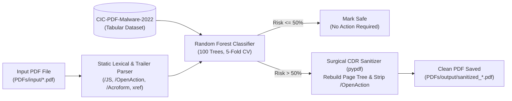

# Artificial Intelligence and Cybersecurity Portfolio


Machine learning security models, notebooks, and flagship project for **Artificial Intelligence and Cybersecurity**. This repository features a **PDF Malware Detection & Behavioral Sanitization Engine** alongside practical cybersecurity machine learning implementations across spam detection, network anomaly detection, malware decision trees, and intrusion detection.

---

## Flagship Project: PDF Malware Detection & Behavioral Sanitization Engine

📂 **Location:** [`project-pdf-malware-detection/`](./project-pdf-malware-detection/)  
📄 **Full Technical Report:** [`project-pdf-malware-detection/REPORT.md`](./project-pdf-malware-detection/REPORT.md)



### Quick Start
```bash
cd project-pdf-malware-detection
pip install -r requirements.txt
python pdf_malware_detector.py
```

---

## Artificial Intelligence and Cybersecurity — Lab Portfolio

All machine learning security implementations are organized under [`labs/`](./labs/):

| Lab | Topic | Key Algorithms & Techniques | Directory |
| :--- | :--- | :--- | :--- |
| **Lab 03** | Cyber Incident Cost Modeling | Linear Regression, MSE Evaluation, Feature Scaling | [`labs/Lab-03-Linear-Regression-Cyber-Cost-Analysis/`](./labs/Lab-03-Linear-Regression-Cyber-Cost-Analysis/) |
| **Lab 04** | TF-IDF Email/SMS Spam Detection | Term Frequency–Inverse Document Frequency (TF-IDF), NLP Tokenization | [`labs/Lab-04-TFIDF-Spam-Detection/`](./labs/Lab-04-TFIDF-Spam-Detection/) |
| **Lab 05** | Perceptron & Single-Layer Neural Networks | Perceptron Learning Rule, Binary Classification Boundaries | [`labs/Lab-05-Perceptron-Neural-Networks/`](./labs/Lab-05-Perceptron-Neural-Networks/) |
| **Lab 06** | Gaussian Network Anomaly Detection | Multivariate Gaussian Distribution ($p(x) < \epsilon$), Network Log Profiling | [`labs/Lab-06-Gaussian-Network-Anomaly-Detection/`](./labs/Lab-06-Gaussian-Network-Anomaly-Detection/) |
| **Lab 07** | Phishing, SMS Spam & Fake News Classification | Support Vector Machines (SVM) vs. Perceptron Comparative Analysis | [`labs/Lab-07-SVM-and-Perceptron-Spam-FakeNews/`](./labs/Lab-07-SVM-and-Perceptron-Spam-FakeNews/) |
| **Lab 08** | PE/Artifact Malware Detection | Decision Tree Classifiers, Gini Impurity, Feature Importance | [`labs/Lab-08-Malware-Detection-Decision-Trees/`](./labs/Lab-08-Malware-Detection-Decision-Trees/) |
| **Lab 09–10** | Network Intrusion Detection (NSL-KDD) | Multi-Class Attack Classification (DoS, Probe, R2L, U2R) on NSL-KDD | [`labs/Lab-09-10-NSL-KDD-Network-Attack-Classification/`](./labs/Lab-09-10-NSL-KDD-Network-Attack-Classification/) |
