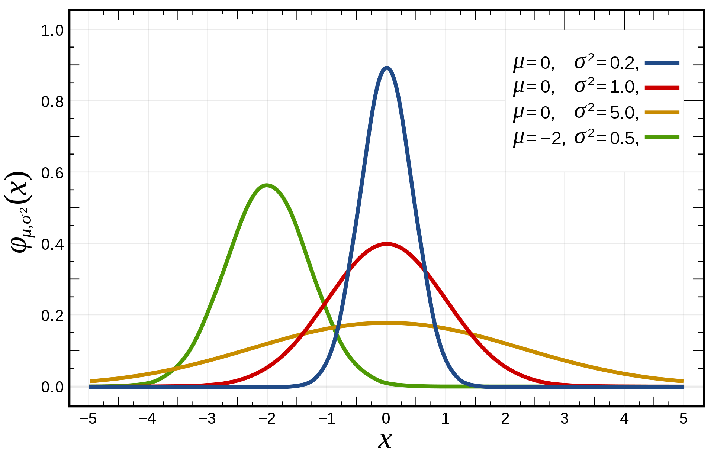

# Gaussian Network Anomaly Detection
**Domain:** Artificial Intelligence and Cybersecurity  
**Files:** [`gaussian_anomaly_detection.py`](./gaussian_anomaly_detection.py), [`gaussian_anomaly_detection.ipynb`](./gaussian_anomaly_detection.ipynb), [`network-logs.csv`](./network-logs.csv)

## Overview
Estimates multivariate Gaussian parameters ($\mu, \sigma^2$) over network telemetry (`network-logs.csv`) to flag anomalous network sessions where probability density falls below threshold $p(x) < \epsilon$.

