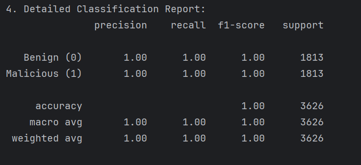
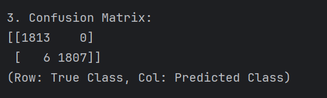
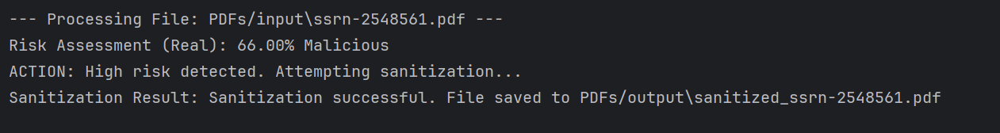

# PDF Malware Detection and Behavioral Sanitization Using Machine Learning
**Domain:** Artificial Intelligence and Cybersecurity

---

## 1. Introduction
PDF files are handled daily across enterprise and personal environments. Because users implicitly trust portable documents, threat actors frequently leverage PDF internal structures to embed malicious scripts, shellcode, and automatic execution triggers. Traditional signature-based antivirus solutions struggle against polymorphic PDF payloads where minor byte modifications invalidate static hashes.

This project implements a two-stage **Static Behavioral Detection & Surgical File Sanitization Engine**:
1. **Supervised Machine Learning Detection:** A **Random Forest Classifier** trained on the **CIC-PDF-Malware-2022** dataset analyzes structural metadata and suspicious keyword frequencies (`/JS`, `/JavaScript`, `/OpenAction`, `/Acroform`, `/Launch`) without executing the document.
2. **Active Content Disarm & Reconstruction (CDR):** When a document's predicted malicious probability exceeds the risk threshold (`> 50%`), the engine creates a clean blank PDF container, copies only verified visual page trees via `pypdf`, and surgically strips executable root dictionary triggers (`/OpenAction`, `/Names`).

---

## 2. AI/ML Model Architecture & Engineering Rationale

### Why Random Forest Over Deep Learning for Tabular PDF Metadata
While Deep Neural Networks excel on unstructured imagery or raw text, the **CIC-PDF-Malware-2022** dataset consists of structured tabular telemetry (object counts, stream sizes, and PDF dictionary tag frequencies). **Random Forest (`n_estimators=100`, 5-fold stratified cross-validation)** was selected for three core engineering reasons:
* **Tabular Efficiency:** Achieves high precision and recall on structured structural features without GPU training overhead.
* **Interpretability:** Provides explicit feature-importance attribution (e.g., pinpointing anomalous `/JS` or `/OpenAction` counts) rather than opaque black-box weights.
* **Outlier Resilience:** Ensemble bagging across 100 decision trees prevents overfitting to malformed PDF headers.

### 2.1 Static Feature Extraction Pipeline
Rather than executing files in a sandbox, `extract_detection_features()` inspects the raw binary stream (`latin-1`) and `pypdf` trailer structure for 20+ structural indicators:
* **Lexical Indicators:** `obj`, `endobj`, `stream`, `endstream`, `xref`, `trailer`, `startxref`, `/Encrypt`, `/ObjStm`, `/JS`, `/JavaScript`, `/AA`, `/OpenAction`, `/Acroform`, `/JBIG2Decode`, `/RichMedia`, `/Launch`, `/EmbeddedFile`, `/XFA`, `/URI`.
* **Structural Root Inspection:** Verifies `isEncrypted` and checks the PDF `/Root` trailer directly for `/OpenAction` and `/Acroform` dictionaries.

### 2.2 Surgical PDF Sanitization Engine (`sanitize_pdf_structure`)
Instead of attempting in-place binary patching, the sanitizer reconstructs the document from scratch:
1. Instantiates a fresh `PdfWriter()` object.
2. Iterates over `reader.pages` to copy visual page content while leaving behind unreferenced orphan objects and hidden streams.
3. Strips `/OpenAction` and `/Names` execution hooks from the document root before writing `sanitized_<filename>.pdf`.

---

## 3. Experimental Results

The model was trained and evaluated using an 80/20 stratified train-test split alongside 5-fold cross-validation on **CIC-PDF-Malware-2022**.

### 3.1 Model Accuracy & Cross-Validation Metrics

### 3.2 Confusion Matrix

### 3.3 Live Sanitization Verification

---

## 4. Engineering Analysis: False Positives vs. Fail-Safe CDR
During live testing on benign academic manuscripts containing thousands of auto-generated empty objects, the classifier assigned a **66% risk probability** because high object-to-stream ratios mimic malware obfuscation techniques.

Instead of destructively quarantining or deleting the user's file on a false positive, the **Content Disarm & Reconstruction (CDR)** sanitization layer reconstructed the document cleanly—stripping the empty/suspicious dictionary structures while preserving 100% of the readable pages.

---

## 5. References
1. Issa, T. et al. (2022). *CIC-PDF-Malware-2022 Dataset*. Canadian Institute for Cybersecurity.
2. Smutz, C., & Stavrou, A. (2012). *Malicious PDF detection using metadata and structural features*. ACSAC '12.
3. Pedregosa, F. et al. (2011). *Scikit-learn: Machine Learning in Python*. JMLR 12, pp. 2825–2830.
4. *PyPDF Documentation* (2024). The `pypdf` library for PDF manipulation.

